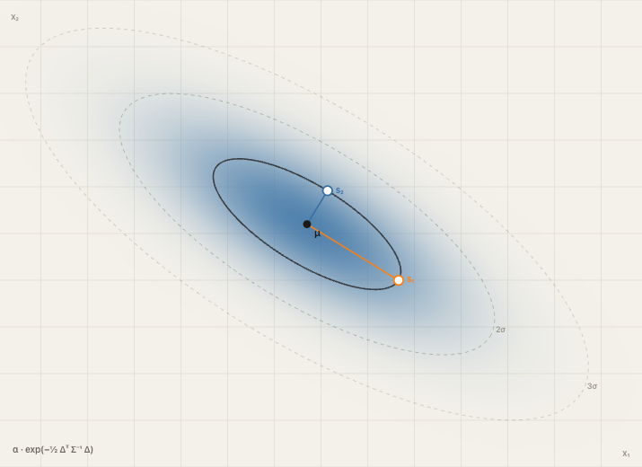
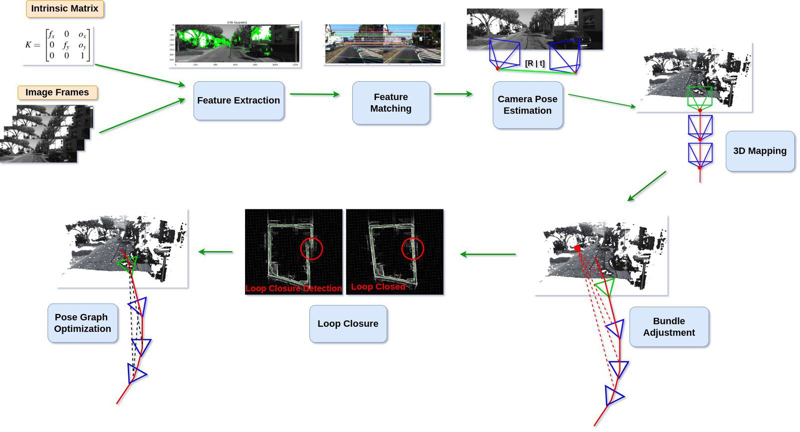

# COLMAP to Gaussian Splats

Produire des scènes 3D Gaussian Splatting à partir d'images ou d'un modèle COLMAP,
puis les exporter, les traiter et les visualiser.

```text
Images → reconstruction des caméras et points 3D → entraînement → export → visualisation
```

## 1. Qu’est-ce que le 3D Gaussian Splatting ?

### 1.1. Qu’est-ce qu’un Gaussian Splat ?

Un Gaussian Splat représente une scène 3D par un ensemble de gaussiennes :
des ellipsoïdes colorés dotés d’une position, d’une taille, d’une orientation
et d’une opacité. Depuis un point de vue, elles sont projetées sur l’image puis
compositées pour produire le rendu.

Contrairement à un maillage composé de surfaces, cette représentation décrit
directement l’apparence de la scène depuis plusieurs points de vue. Une fois
entraîné, le modèle peut être rendu et exploré en temps réel sur un matériel
adapté.



### 1.2. Principe général

```text
Images + modèle COLMAP
        ↓
Initialisation des gaussiennes avec le nuage de points
        ↓
Entraînement GPU (Splatfacto ou Spirula)
        ↓
Export → post-traitement éventuel → visualisation
```

COLMAP met en correspondance les images et estime les paramètres des caméras
ainsi qu’un nuage de points 3D clairsemé. L’entraînement ajuste les gaussiennes
pour rapprocher les vues synthétiques des images d’entrée.



## Construire le résultat étape par étape

Commencer par le [guide utilisateur](doc/guide_utilisateur.md) pour comprendre
le résultat.

1. **Produire les données COLMAP** : reconstruire les caméras et les points 3D
   depuis les images avec les [outils de préparation](tools/preprocess/README.md),
   ou utiliser un modèle COLMAP existant avec ses images.
2. **Choisir l'entraînement** : utiliser
   [Nerfstudio / Splatfacto](doc/nerfstudio.md) ou
   [Spirula](doc/guide_utilisateur.md#22-choisir-lentraînement).

```text
Images → données COLMAP → Nerfstudio / Splatfacto ou Spirula → Gaussian Splat
```

Les deux moteurs proposés sont :

- **[Nerfstudio](https://github.com/nerfstudio-project/nerfstudio)** : framework
  Python de reconstruction et de rendu 3D, dont **Splatfacto** est la méthode
  Gaussian Splatting utilisée ici. Développé et maintenu par l'équipe
  **Nerfstudio**, issue de **Berkeley / KAIR (BAIR)**, et les contributeurs
  de la communauté.
- **[Spirula Studio](https://github.com/harry7557558/spirula-studio)** : outil
  de reconstruction et d'entraînement Gaussian Splatting intégrant notamment
  le SfM et les masques, avec un backend GPU Vulkan. Projet maintenu par
  **harry7557558**, ingénieur indépendant qui le développe seul.

## Utiliser un pipeline complet

Deux pipelines dans `tools/` enchaînent la préparation des données COLMAP,
l'entraînement et l'export. Ils utilisent **uniquement Spirula** :

- **Bbox + flux Panoramax → splat** :
  [téléchargement et pipeline Panoramax](tools/panoramax/README.md).
- **Images locales → splat** :
  [pipeline images vers splat](tools/images_to_splat/README.md).

## Démarrer

Pour le pipeline images locales, depuis la racine du dépôt :

```bash
cp tools/images_to_splat/config.sh.example /chemin/config.sh
# Adapter les chemins et réglages dans /chemin/config.sh.
bash tools/images_to_splat/run_pipeline.sh /chemin/config.sh
```

Les installations, données attendues, paramètres et sorties sont décrits dans
le README du pipeline choisi.

## Outils

- [Préparation des images et modèles COLMAP](tools/preprocess/README.md).
- [Installation de Spirula](tools/spirula/README.md).
- [Masques](tools/segmentation_masks/README.md).
- [Export, filtrage et fusion](tools/postprocess/README.md).
- [Nettoyage multivues du ciel](tools/clean_gs/README.md).
- [Visualisation](tools/viewer/README.md).
- [Conversion en 3D Tiles](tools/splat_to_3dtiles/README.md).
