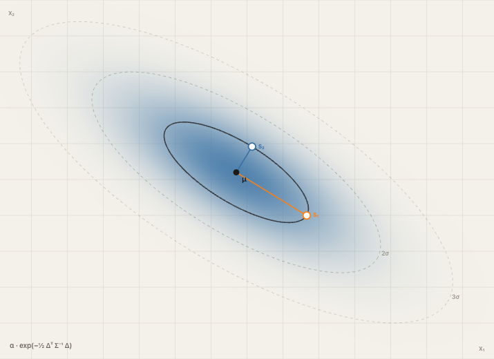
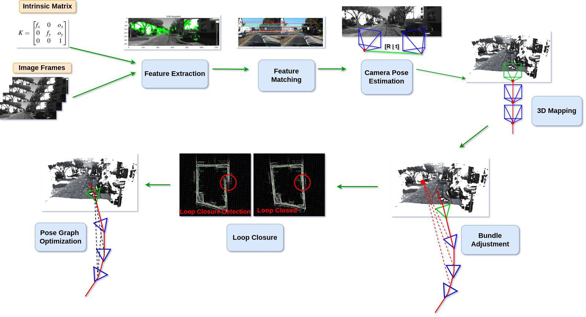

# Guide utilisateur — produire et visualiser un Gaussian Splat

[Accueil du projet](../README.md)

Ce guide présente le principe des Gaussian Splats et les grandes étapes pour
transformer des images en une scène 3D visualisable. Les commandes complètes,
options, paramètres et détails de chaque outil sont documentés dans les README
spécialisés liés ci-dessous.

## 1. Comprendre le résultat

### 1.1. Qu'est-ce qu'un Gaussian Splat ?

Un Gaussian Splat représente une scène 3D par un ensemble de gaussiennes :
des ellipsoïdes colorés dotés d'une position, d'une taille, d'une orientation
et d'une opacité. Depuis un point de vue, elles sont projetées sur l'image puis
compositées pour produire le rendu.

Contrairement à un maillage composé de surfaces, cette représentation décrit
directement l'apparence de la scène depuis plusieurs points de vue. Une fois
entraîné, le modèle peut être rendu et exploré en temps réel sur un matériel
adapté.



### 1.2. Principe général

```text
Images + modèle COLMAP
        ↓
Initialisation des gaussiennes avec le nuage de points
        ↓
Entraînement GPU (Splatfacto ou Spirula)
        ↓
Export → post-traitement éventuel → visualisation
```

COLMAP met en correspondance les images et estime les paramètres des caméras
ainsi qu'un nuage de points 3D clairsemé. L'entraînement ajuste les gaussiennes
pour rapprocher les vues synthétiques des images d'entrée.



## 2. Choisir un parcours

Le dépôt propose plusieurs parcours. Choisir celui qui correspond aux données
disponibles :

- **Dataset COLMAP existant, Nerfstudio / Splatfacto** : consulter le
  [guide Nerfstudio](nerfstudio.md) pour les prérequis, l'environnement, le
  lancement de `scripts/run.sh`, les sorties et l'exécution sur Slurm.
- **Images locales, pipeline Spirula** : voir
  [Images locales vers Gaussian Splats](../tools/images_to_splat/README.md).
- **Recherche et téléchargement d'images Panoramax par bbox** : voir le
  [pipeline Panoramax](../tools/panoramax/README.md).
- **Préparation d'images, reconstruction COLMAP, découpage et filtre sparse** :
  consulter les outils décrits dans
  [Préparation des données](../tools/preprocess/README.md).

## 3. Préparer les données et lancer un calcul

Le principe commun est de fournir des images et un modèle COLMAP cohérent :
les caméras, images enregistrées et points 3D doivent décrire la même scène.
Selon le parcours choisi, le dépôt peut préparer ce modèle ou réutiliser un
dataset déjà constitué.

Pour le pipeline Nerfstudio / Splatfacto, le point d'entrée est
`scripts/run.sh`. Exemple :

```bash
./scripts/run.sh \
  --dataset-dir /chemin/absolu/vers/mon_dataset \
  --output-dir /chemin/absolu/vers/mes_resultats \
  --gsplat-profile balanced \
  --name ma_scene
```

Cette commande illustre le lancement ; les options, valeurs possibles,
prérequis et étapes exécutées sont décrits dans le
[guide Nerfstudio](nerfstudio.md#3-configuration-et-utilisation).

Pour les autres parcours, utiliser les commandes et fichiers de configuration
de leur README : le pipeline images locales et le pipeline Panoramax ont des
étapes et sorties propres.

## 4. Consulter les guides des outils

- **Lancement Bash ou Slurm, ressources et suivi des jobs** :
  [guide de lancement](lancement_bash_slurm.md).
- **Préparation des données et sparse COLMAP** :
  [tools/preprocess](../tools/preprocess/README.md).
- **Masques de segmentation** :
  [tools/segmentation_masks](../tools/segmentation_masks/README.md).
- **Filtrage et fusion des splats** :
  [tools/postprocess](../tools/postprocess/README.md).
- **Nettoyage multivues du ciel** :
  [tools/clean_gs](../tools/clean_gs/README.md).
- **Installation de Spirula** :
  [tools/spirula](../tools/spirula/README.md).
- **Visualisation locale** :
  [tools/viewer](../tools/viewer/README.md).
- **Conversion d'un SPLAT géoréférencé en 3D Tiles** :
  [tools/splat_to_3dtiles](../tools/splat_to_3dtiles/README.md).

Ces documents détaillent les paramètres, dépendances, fichiers produits,
commandes de validation et particularités de chaque outil.

## 5. Limites, conseils pratiques et à savoir

- Une couverture suffisante de la scène et des points de vue variés sont
  importants ; des images prises presque sous le même angle peuvent mal
  contraindre la géométrie.
- Les surfaces cachées dans les images ne sont pas reconstruites de façon
  fiable par le seul apprentissage des splats.
- Les très grandes images et les scènes volumineuses peuvent demander beaucoup
  de mémoire et de temps de calcul.
- Des artefacts et des splats parasites peuvent apparaître, notamment aux
  limites de la scène ou dans les zones peu observées.
- Le résultat est une représentation visuelle complémentaire : il ne remplace
  pas automatiquement un maillage ou un produit géospatial répondant à des
  exigences métriques.
- Les scènes aériennes ou géoréférencées peuvent nécessiter des traitements
  complémentaires et ne garantissent pas à elles seules une reconstruction
  fiable.

Le pipeline Nerfstudio conserve un `transforms.json` déjà présent. Pour repartir
des paramètres COLMAP courants, supprimer ce fichier avant de relancer
`scripts/run.sh`. Les détails de ce comportement et des transformations sont
dans le [guide Nerfstudio](nerfstudio.md#2-entrées-et-sorties).
