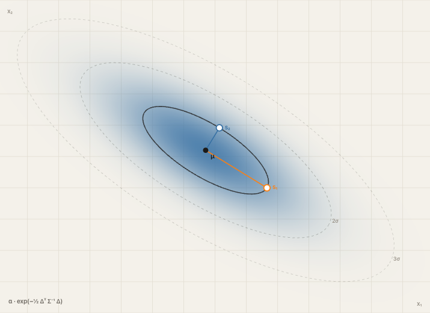
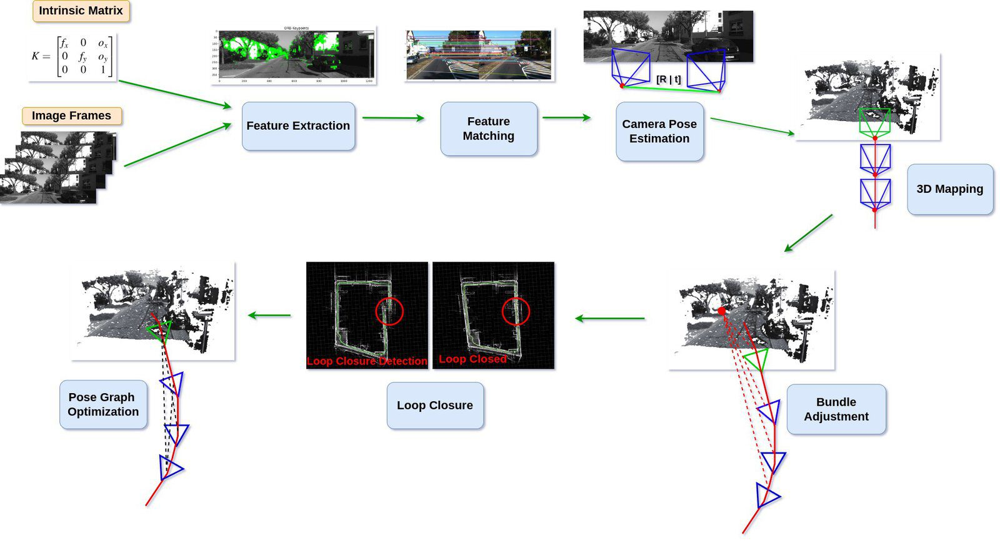
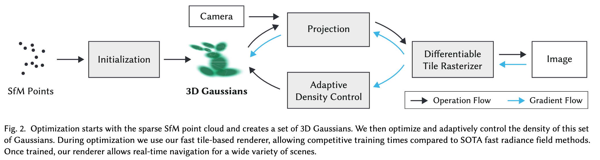

# Les splats gaussiens, une nouvelle manière de représenter nos données 3D

## 1. Un Gaussian Splat, c'est quoi ?
--

Pour représenter une scène en trois dimensions, on utilisait en général :
- **un maillage texturé** : une surface composée de triangles, sur laquelle sont projetées des images
- **un nuage de points** : des positions 3D, éventuellement accompagnées de couleurs

Récemment, deux approches paramétriques modernes se sont imposées :
a) **Les NeRF (Neural Radiance Fields)** :  un réseau neuronal encode la radiance (couleur + luminosité) en fonction de la position et de la direction d'observation.
- ✓ Qualité visuelle exceptionnelle
- ✗ Rendu très lent (secondes par image)

b) L**es 3D Gaussian Splatting** : la scène est décrite par un ensemble de **gaussiennes 3D** : des ellipsoïdes colorés avec une certaine opacité.
Chaque gaussienne possède :
une **position** dans l'espace ;
  - une **échelle** et une **rotation**, qui définissent sa forme et son orientation ;
  - une **opacité** ;
  - des **attributs de couleur**, pouvant représenter une apparence qui varie selon la direction d'observation.

   
  <em>Source : <a href="https://brunzema.github.io/visualizations/gaussian-splatting">A visual exploration of Gaussian Splatting — Paul Brunzema</a></em>

Le rendu peut alors se faire en **temps réel**, permettant une navigation 3D immersive avec une finesse de rendu très au-dessus des approches plus classiques.

[Démo interactive: Niseko Village — Snowy Ski Resort [Source : Splat Labs — Gaussian Splatting](https://cloud.splatlabs.ai/viewer/0729c1d5-8d65-4dbc-b4f4-a7ed4fbd6ce3)]

## 2. Pourquoi s'y intéresser maintenant ?
---

### 2.1 Maturité de la technologie : d'un sujet de recherche à une brique standardisée
Les Gaussian Splats ne sont plus une technique expérimentale confinée à la recherche académique. Ils s'imposent comme **le paradigme dominant pour la visualisation 3D immersive et interactive** à grande échelle.
**Signaux forts de maturité technologique :**
- **Standardisation dans l'écosystème glTF** : le groupe **Khronos**, qui définit la plupart des standards de rendu graphique 3D, a annoncé l'intégration des Gaussian Splats comme primitive 3D officielle dans les standards web et géospatiaux.
- **Intégration dans les workflows de streaming géospatial** : **Cesium** offre désormais un support natif des Gaussian Splats dans les **3D Tiles**, avec gestion hiérarchique du LOD (Level of Detail) pour le streaming progressif de scènes massives.
- **Exploration des formats 360°** : des outils comme **360 Splat Pro** appliquent la technologie aux panoramas, ouvrant de nouveaux usages de capture.
- **Adoption par les géants de la cartographie** : **Google** (Immersive View) et **Apple** (Detailed City Experience) renforcent leurs offres de cartographie 3D photoréaliste immersive.
- **Accessibilité croissante du calcul GPU** : les ressources GPU deviennent progressivement standardisées dans les environnements informatiques (cloud, serveurs HPC, workstations). Cette démocratisation du calcul GPU rend les méthodes d'entraînement autrefois réservées à la recherche de plus en plus accessibles pour des usages opérationnels.

### 2.2 Valoriser l’existant : enrichir les usages de nos données
L’IGNF dispose d’un patrimoine de données géoréférencées dont les Gaussian Splats pourraient offrir une **nouvelle forme de restitution 3D photoréaliste** :
- Prises de vues aériennes  (**PCRS**, autres PVA haute et très haute résolution)
- Nuages de points **LiDAR**
- **Acquisitions Stéréopolis**, pour restituer les environnements urbains depuis le sol
- **Acquisitions à façon des Travaux Spéciaux**, pour des sites ou des besoins spécifiques

L’intérêt serait de **tirer davantage de valeur des acquisitions existantes**, en proposant une exploration immersive complémentaire aux cartes, aux nuages de points et aux maillages : découverte d’un territoire, consultation à distance d’un site ou médiation auprès des utilisateurs.

### 2.3 Explorer de nouvelles offres de capture et de restitution 3D
Les Gaussian Splats invitent également à étudier des **dispositifs d’acquisition légers et ciblés** :**
- véhicule (vélo ou autre) + téléphone portable + GPS : explorer la capture rapide de rues et d’itinéraires, avec un matériel peu coûteux
- **Drone** : documenter un site depuis des points de vue complémentaires, selon les besoins et les contraintes de vol

Pour l’IGNF, l’enjeu serait d’évaluer la possibilité de produire des **scènes 3D immersives à la demande**, sur des zones ciblées ou lors d’acquisitions répétées.

**Conclusion :**  
Les Gaussian Splats sont en transition de **technologie de recherche** à **brique technologique standardisée**. Nous pensons que c'est une technologie en voie d'usage intensif et que l'IGNF doit assurer une veille technologique conséquente et en explorer les potentialités dans les contextes pertinents pour ses domaines d'expertise.

---
## 2. Comment génère-t-on des splats ?
La génération de Gaussian Splats repose sur un apprentissage itératif. Il prend en entrée:
1. des **images de la scène**, prises depuis plusieurs points de vue ;
2. les **paramètres des caméras** : position, orientation et paramètres internes ;
3. une **géométrie initiale**, sous la forme d’un nuage de points 3D peu dense, obtenu par photogrammétrie (on utilise en général colmap).
### Étape 1 : Photogrammétrie et reconstruction de la géométrie initiale

À partir d'un ensemble d'images de la scène, on utilise des méthodes de type **Structure-from-Motion (SfM)** (en général via **COLMAP**) pour :
détecter les points caractéristiques dans chaque image ;
- les mettre en correspondance entre les différentes vues ;
- estimer la **position et l'orientation de chaque caméra** (paramètres extrinsèques) ;
- estimer les **paramètres de calibration des caméras** (paramètres intrinsèques : focale, centre optique) ;
- reconstruire un **nuage de points 3D peu dense** (sparse point cloud) représentant la géométrie grossière de la scène.

   
  <em>Source : <a href="https://learnopencv.com/">LearnOpenCV</a></em>

### Étape 2 : Initialisation et optimisation des Gaussian Splats
Le nuage de points 3D sparse sert à **initialiser une représentation de la scène**. Chaque point est converti en une gaussienne 3D caractérisée par :
sa position dans l'espace, sa taille, son orientation, une opacité et une couleur.
À partir de ces gaussiennes, un moteur d'optimisation sur GPU (typiquement **GSplat**) exécute une boucle d'apprentissage :

1. rend une image de la scène depuis une caméra donnée ;
2. la compare aux images réelles correspondantes ;
3. calcule l'erreur entre le rendu et la réalité ;
4. met à jour les paramètres des gaussiennes pour réduire cette erreur.

Au cours de l’optimisation, la représentation peut également évoluer pour mieux décrire la scène :**
- **Split** : subdiviser des gaussiennes pour mieux représenter les zones complexes ou insuffisamment détaillées.
* **Pruning** : supprimer les gaussiennes peu contributives ou dont l’opacité est trop faible.
* **Culling** : écarter du rendu les éléments qui ne contribuent pas à l’image considérée, par exemple parce qu’ils sont hors du champ de vision.

Ces opérations permettent d’ajuster progressivement la densité et la répartition des gaussiennes en fonction des détails de la scène.

   
  <em>Source : <a href="https://zhangtemplar.github.io/3d-gaussian-splatting/">3D Gaussian Splatting for Real-Time Radiance Field Rendering (2023) — Qiang Zhang</a></em>

## 3. Écosystème technologique et outils disponibles

### 3.1 Solutions commerciales fermées

Plusieurs solutions commerciales proposent des logiciels simplifiés de capture, reconstruction et visualisation de Gaussian Splats, visant la facilité d'usage au prix d'un contrôle limité sur les paramètres internes :

| Solution | Type | Open source | Modèle | Usage principal |
|----------|------|-------------|--------|-----------------|
| **Luma AI** | Cloud SaaS | ❌ | Freemium | Capture et reconstruction 3D automatisées (web/mobile) |
| **Polycam** | Application/SaaS | ❌ | Freemium | Capture terrain, photogrammétrie et Gaussian Splats |
| **Scaniverse** | Mobile | ❌ | Gratuit + Pro | Capture mobile et reconstruction 3D |
| **Postshot** | Desktop | ❌ | Freemium | Reconstruction locale de Gaussian Splats |
| **vid2scene** | SaaS/Local | ✅ (Apache 2.0) | Gratuit | Conversion vidéo → Gaussian Splat |

### 3.2 Frameworks et bibliothèques open source

L'écosystème open source constitue le principal moteur d'innovation. Les différents projets couvrent des besoins complémentaires :

| Projet | Type | Entraînement | Visualisation | Pipeline complet |
|--------|------|--------------|---------------|-----------------|
| **3D Gaussian Splatting (GraphDECO)** | Référence académique de l'INRIA | ✅ | ⚠️ | ❌ |
| **GSplat** | Bibliothèque GPU | ✅ | ❌ | ❌ |
| **Nerfstudio** | Framework complet | ✅ | ✅ | ✅ |
| **OpenSplat** | Implémentation légère | ✅ | ⚠️ | ❌ |
| **Spirula** | Framework multi-backends | ✅ | ✅ | ✅ |

Deux frameworks open source complets se distinguent pour les pipelines de production :

-** Nerfstudio** s'appuie sur **GSplat** comme moteur de rasterisation et d'entraînement. GSplat constitue la couche de calcul GPU (CUDA/PyTorch), tandis que Nerfstudio fournit l'ensemble du pipeline (prétraitement, entraînement, gestion des expériences, visualisation, export).

-** Spirula** propose une architecture plus intégrée, avec une interface et le support de données géoréférencées : intégration directe du GPS et du LiDAR . Cette approche facilite le traitement de données calibrées et géolocalisées, répondant directement aux besoins des données IGNF. 
Nerfstudio a constitué la solution principale d'expérimentation dans ces travaux. Spirula ayant été identifié récemment (release publique datant d'aout 2026, merci à Alexandre Devaux pour la veille techno).

---

## 4. Expérimentations réalisées
Les expérimentations qui suivent visent à évaluer comment les Gaussian Splats fonctionnent sur différents types de données géospatiales. Elles ont été menées avec **Nerfstudio** comme solution principale.
**Spirula Studio **a également été testé mais plus récemment,  le recul manque pour une comparaison approfondie au-delà des éléments mentionnés ci-dessus.
### 4.2 Environnement de calcul
Seule la phase d’**entraînement des Gaussian Splats** nécessite des ressources de calcul GPU. 
Les étapes de reconstruction photogrammétrique (COLMAP / HLOC), de préparation des données et d’export restent exécutables sur CPU.
Deux environnements ont été utilisés avec Nerfstudio :
- **Google Colab** : premiers tests exploratoires sur de petites scènes, avec les limites du compte gratuit en matière de disponibilité des ressources GPU (environ 5 h de calcul tous les 48 h) et de pérennité des données.
- **SLURM sur le cluster HPC Jean-Zellou** : environnement principal pour l’exécution de pipelines complets et reproductibles sur des jeux de données volumineux, avec des GPU NVIDIA A40. Nerfstudio s’appuie sur CUDA pour l’entraînement accéléré par GPU, ce qui oriente son utilisation vers des GPU NVIDIA compatibles.

**Spirula Studio** a également été testé comme alternative. Grâce à la prise en charge de **Vulkan**, il permet d’exploiter le GPU intégré des Mac Apple Silicon, notamment sur macOS, sans dépendre de CUDA. Il prend également en charge les environnements équipés de GPU NVIDIA via CUDA, offrant ainsi une plus grande flexibilité dans le choix de l’environnement de calcul.

### 4.3 Jeux de données utilisés
Quatre types de données ont été testés pour évaluer l'intérêt de la technologie :**
1. **Captures smartphone (iPhone 8)** : vidéos autour d'objets simples (arbuste, statue)
2. **PCRS + LiDAR** : orthophotographies aériennes + nuage LiDAR structuré
3. A**cquisition drone OpenData de l'ISPRS** : 224 images aériennes (7952 × 5304 px, altitude 80m, recouvrement 80%, résolution 1.7 cm/pixel)
4. **Panoramas 360°** : vidéo GoPro Max 2  acquis en vélo (8K équirectangulaire, ~1100 images extraites)

### 4.4 Expérience 1 : Vidéos non structurées
**Objectif :** S'approprier la technologie, valider le fonctionnement du pipeline sur des données simples non calibrées.
**Processus :**
1. Extraction des frames via ffmpeg
2. Lancement SfM COLMAP complet
3. Entraînement splatfacto
4. Export et nettoyage du `.ply`

**Résultats :**
- ✓ Reconstruction réussie pour objets simples
- ✓ Navigation fluide en temps réel
- ✗ Artefacts en bords de scène

**Vidéo source :** [Voir la vidéo de la statue](../../../TECHNO_PITCH/examples/statue/)

**Résultat interactif :** <a href="http://127.0.0.1:8000/?file=%2F__datasets__%2Fexamples%2Fstatue%2Fsplat.ply&flipUp=0&camera_pos=0.00603432696582,0.288282880779,0.0980095024881,-0.0130298620721,0.0384080264849,0.0680299727369,-0.0219747022422,-0.117442163726,0.992836567941" target="_blank" rel="noopener noreferrer">Ouvrir la démo interactive</a>

**Bilan :** Appropriation réussie du pipeline de base. Limitations sur les bords et présence de splats parasites.

### 4.5 Expérience 2 : PCRS + LiDAR
**Objectif :** Exploiter données aériennes géoréférencées avec initialisation LiDAR.
**Processus :**
1. Conversion CON/XML + LiDAR vers format COLMAP
2. Sous-échantillonnage des images (résolution native incompatible avec le pipeline de NerfStudio : 26460 × 17004 px)
3. Entraînement
4. Nettoyage spatial basé sur géométrie LiDAR

**Résultats :**
- ✓ Reconstruction médiocre (jeu test sur Aubigny-sur-Nère, Cher)
- ✓ Le LiDAR aide beaucoup à stabiliser la géométrie, mais une PVA aérienne n'est pas adaptée à ce type de calcul
- ✗ Gestion difficile de très haute résolution

**Données :** [Voir l'inspecteur photogrammétrique]

**Résultat interactif :** <a href="http://127.0.0.1:8000/?file=%2F__datasets__%2Fexamples%2FPCRS%2FAubigny_ssech2_bbox_PCRS6.ply&flipUp=1&camera_pos=-0.488475828454%2C2.41109437885%2C-0.414503715087%2C-0.429732941091%2C2.95050740242%2C-0.206108570099%2C0.176423084482%2C-0.371383575262%2C0.911564114743" target="_blank" rel="noopener noreferrer">Ouvrir la démo interactive</a>
 
**Bilan :** Il faudra refaire des tests quand on aura une meilleure maitrise de cette technologie mais il est peu probable qu'on obtienne de bons résultats sans données complémentaires. La faible varieté d'angles n'est pas adapté à cette technlogie

### 4.6 Expérience 3 : Drone haute-résolution (jeu test Open Data de l'ISPRS)
**Objectif :** Évaluer reconstruction sur des données drone.
**Données :**
- 224 images aériennes (dataset ISPRS UseGeo)
- Résolution : 7952 × 5304 px
- Altitude : 80 m, recouvrement : 80%, résolution spatiale : ~2cm/pixel

**Calcul :**
- Difficulté à m'approprier le format d'orientation des caméras (probablement la calibration de la camera) donc à fusionner correctement le LidAR
- Problème des parties cachées (tentative de Z-Buffer)

**Résultats :**
- ✓ Reconstruction intéressante mais nécessiterait une meilleure maîtrise de la géométrie
- ✓ Rendu végétation très réaliste

**Données :** [Voir l'inspecteur photogrammétrique]

**Résultat interactif :** <a href="http://127.0.0.1:8000/?file=%2F__datasets__%2Fexamples%2Fdrone%2Fdrone_ISPRS.ply&flipUp=1&camera_pos=0.13649458068%2C-0.324329047252%2C-0.31929885544%2C0.056428973799%2C-0.0316349491067%2C0.000948168820011%2C-0.267862696535%2C0.676887099571%2C-0.685619012454" target="_blank" rel="noopener noreferrer">Ouvrir la démo interactive</a>

**Bilan :** 
- Cas d'usage prometteur, si l'IGNF souhaite exploiter des donneés drone.
- Données terrestres des Travaux Spéciaux à étudier avec un pipeline similaire (dans ma TO-DO list)

### 4.7 Expérience 4 : Paris à vélo (GoPro 360°)

>> **ALEXANDRE DEVAUX**
---

## 5. Limites observées

À l'issue de ces quatre expériences, plusieurs défis pratiques sont apparus :

- **Temps de traitement** : phases de préparation, d'entraînement et de post-traitement restent coûteuses en temps pour jeux volumineux.

- **Difficultés avec très grandes images** : sous-échantillonnage des images PCRS (26460 × 17004 px) pose problèmes de mémoire GPU.

- **Maîtrise des bords de scène** : limites de la zone reconstruite difficiles à contrôler, artefacts fréquents en périphérie.

- **Splats parasites** : gaussiennes isolées ou incohérentes en zones peu contraintes, arrière-plans, transitions de profondeur.

- **Difficulté d'évaluation objective** : reste difficile de quantifier la qualité finale et d'identifier paramètres optimaux.

- **Dépendance forte à la configuration de prise de vue**

- **Géoréférencement**
- **Tuilage**
- **Optimisation des temps de traitement**

---

## 6. Bilan et perspectives

1. Poursuivre l'expérimentation sur d'autres jeux de données
2. Investir dans l'optimisation des pipelines
3. Explorer les nouveaux usages (consultation immersive, monitoring temporel, services à la demande)
4. Assurer la veille sur évolutions technologiques et standards (glTF, 3D Tiles, Spirula, Nerfstudio)

> **Conclusion :** Les Gaussian Splats offrent une réelle opportunité pour valoriser nos données.
> Les travaux menés ont montré la faisabilité, mais des efforts d'optimisation demeurent nécessaires
> avant un passage à l'échelle.
--
